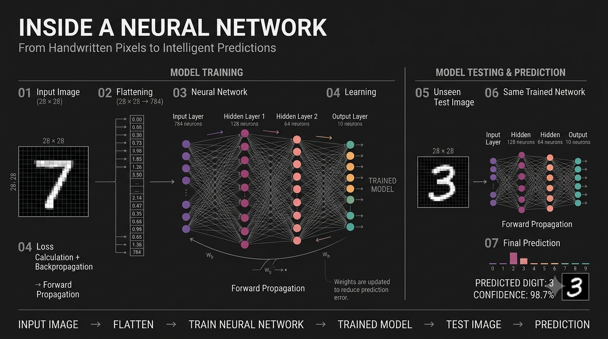

# Handwritten Digit Recognition (MNIST)

A simple neural network that looks at an image of a handwritten digit (0 to 9) and tells you what digit it is.

I made this to actually understand how a neural network learns, not just call `.fit()` and move on. It gets about **97.4%** on the test set.



*The image is a simplified illustration.*

## What it does

1. Takes a 28x28 grayscale image of a digit
2. Flattens it into 784 numbers
3. Passes it through the network
4. Gives back a probability for each digit, the highest one is the prediction

## Dataset

[MNIST](https://en.wikipedia.org/wiki/MNIST_database), it comes built into Keras.

- 60,000 training images
- 10,000 test images
- Each image is 28x28 pixels, values from 0 to 255

I divided every pixel by 255 so all values sit between 0 and 1. Neural networks train much better this way.

## The model

```
Input (28x28)
   ↓ Flatten
784
   ↓ Dense + ReLU
128
   ↓ Dense + ReLU
128
   ↓ Dense + Softmax
10
```

Total params: **118,004**

| Thing | What I used |
|---|---|
| Loss | sparse categorical crossentropy |
| Optimizer | Adam |
| Epochs | 5 |
| Validation split | 20% of training data |

## Results

| | Accuracy |
|---|---|
| Training | 98.56% |
| Test | 97.37% |

Training accuracy is a bit higher than test accuracy, so the model is overfitting a little, but not badly. Validation loss also stopped improving after epoch 3, so more epochs would probably not help without regularization.

## Things I noticed (honest section)

- I wrote `Dropout(0.3)` in my code but it never actually got added. I passed it as a second argument to `model.add()` instead of adding it as its own layer. You can see it in the param count, no dropout layers in `model.summary()`. So the model above is trained **without** dropout. Fixing this is on my list.
- My second hidden layer has 126 neurons, not 128. That was a typo and I kept it. Doesn't change much, but it's there.

## Run it yourself

```bash
git clone <your-repo-link>
cd <your-repo-name>
pip install numpy pandas matplotlib seaborn scikit-learn tensorflow
jupyter notebook digit.ipynb
```

Run the cells from top to bottom. Training takes about 20 seconds.

## Next things to try

- [ ] Fix the dropout and compare results
- [ ] Try a CNN, should go above 99%
- [ ] Let people draw their own digit and predict it
- [ ] Look at which digits the model confuses the most (confusion matrix)

## Built with

Python, TensorFlow/Keras, NumPy, Matplotlib

---

This is a personal learning project, so I'm not accepting contributions. Feel free to fork it and play with it on your own.
